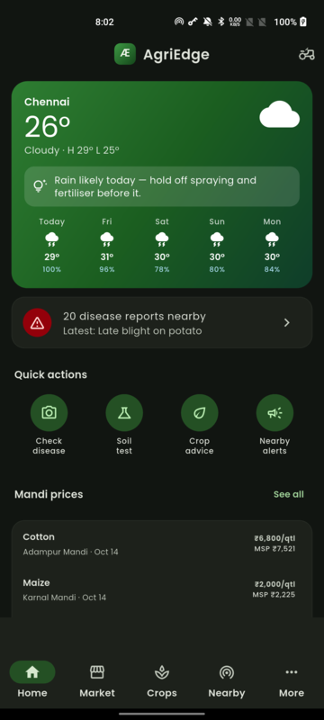
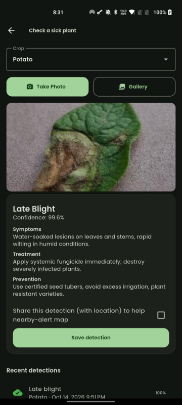
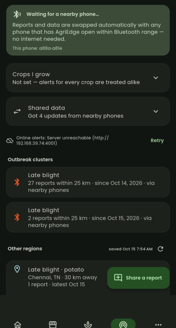
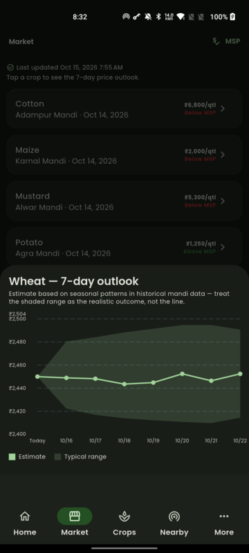
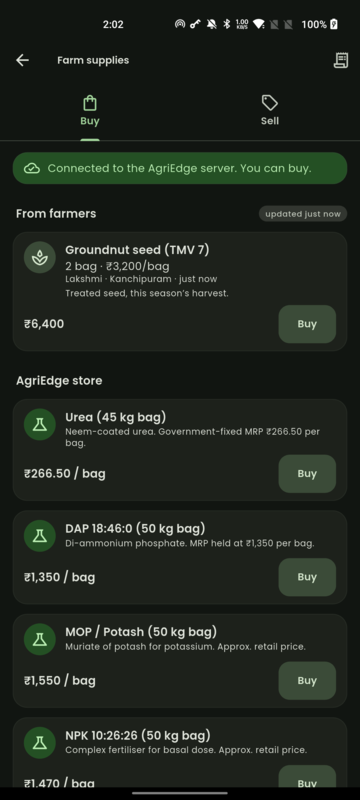
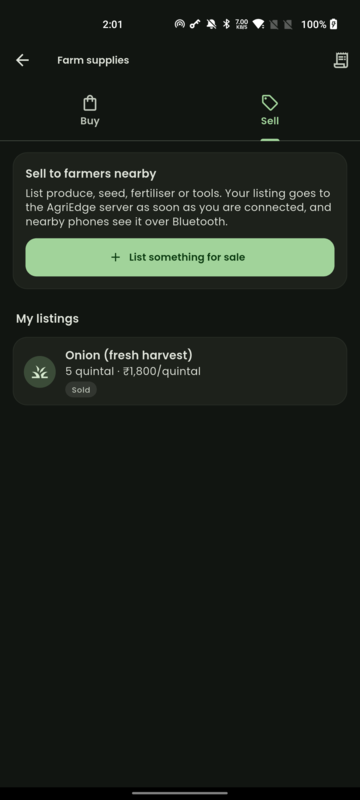
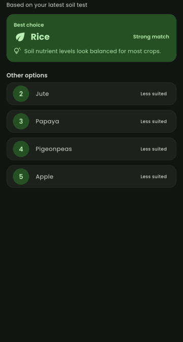
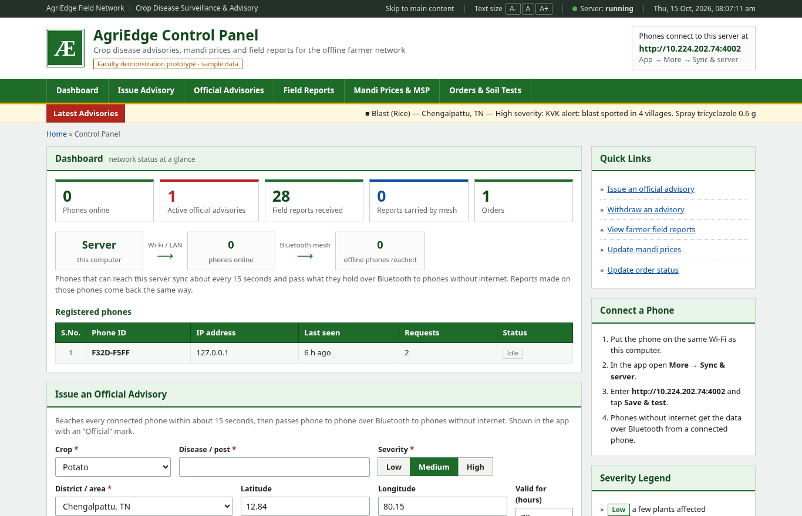
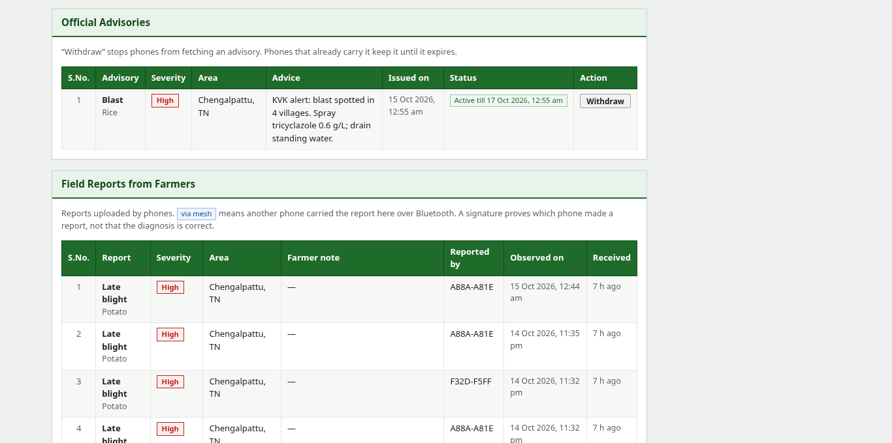
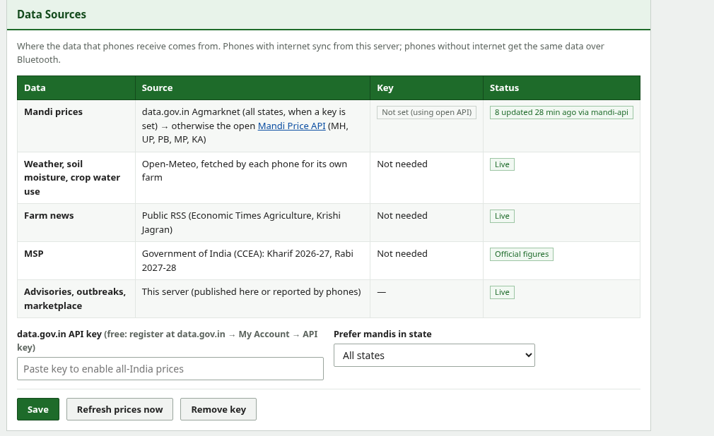

# Æ AgriEdge

**Offline-first farming assistant for Android.** AgriEdge checks crop leaves for disease on the phone itself, suggests what to grow from a soil test, shows mandi prices with a 7-day outlook, and passes disease alerts from phone to phone over **Bluetooth**, so farmers without internet still get warnings. An online **control panel** lets officials publish advisories and update prices. Phones with internet pick them up and relay them to phones that have none.

**🌐 Live server: [https://agriedge-yztd.onrender.com](https://agriedge-yztd.onrender.com)**. The control panel is password-protected, and phones connect to the same address from any network.

> Faculty demonstration prototype. Mandi prices are **live Agmarknet data**, MSP figures are the **official 2026-27 / 2027-28 rates**, and weather is live from Open-Meteo (see [docs/DATA_SOURCES.md](docs/DATA_SOURCES.md)). The regional outbreak examples outside the demo area are demonstration data. The ML models are real, but they are tuned to be "good enough" for a demo, not field-validated.

<p align="center">
  
  
  
  
</p>

---

## Download the app

**[⬇ release/AgriEdge.apk](release/AgriEdge.apk)** (Android 7.0+, about 81 MB)

**🍃 Demo leaf images: [demo/AgriEdge-demo-leaf-images.zip](demo/AgriEdge-demo-leaf-images.zip)**. Five checked images per crop, in folders named after the crop to choose in **Check a sick plant**. Each file name says what the app should answer.

1. Open the link above on GitHub and press **Download raw file**.
2. Open the downloaded file on the phone and allow **Install unknown apps** when asked.
3. Allow **Bluetooth (Nearby devices)** and **Location** when the app asks. They are needed for phone-to-phone sharing.
4. To connect to the live server, open **More → Sync & server**, enter `https://agriedge-yztd.onrender.com` and tap **Save & test**. Any internet connection works.

The APK is signed with a development key, so Play Protect may warn that the app is from an unknown developer. Choose **Install anyway**.

## What it does

| Feature | How it works | Needs internet? |
|---|---|---|
| **Disease check** | Take or pick a leaf photo (try the [demo images](demo/AgriEdge-demo-leaf-images.zip)). On-device TFLite (LiteRT) models for potato, rice, wheat, cotton and corn/sugarcane give a diagnosis with symptoms, treatment and prevention. Below 60 % confidence it says "Not sure" and shows the top two guesses. | No |
| **Nearby alerts (Bluetooth mesh)** | Reports, official advisories, prices and weather are exchanged automatically with any phone running AgriEdge within Bluetooth range: signed, deduplicated, store-and-forward. A shared disease check carries a compressed photo (up to about 100 KB) and its exact location. Tap any report, or any outbreak under **Other regions**, for the photo, the model's prediction, exact coordinates and **Open in Maps**. | No |
| **Gateway relay** | A phone that reaches the server uploads reports it received from offline phones and brings official advisories back down to them. | One phone does |
| **Crop advice** | Enter Soil Health Card values (N, P, K, pH, OC, climate). An on-device model ranks suitable crops. | No |
| **Mandi prices & outlook** | Live Agmarknet prices (median across reporting mandis) against official MSP; tap a crop for a 7-day forecast with a realistic range band. | To refresh |
| **Weather & news** | Forecast with spray/irrigation hints, topsoil moisture and crop water use; agriculture news. A saved copy is shown when offline. | To refresh |
| **Farm supplies: Buy / Sell** | **Sell:** list produce, seed or tools (works offline; uploads when connected). **Buy:** farmers' listings and the AgriEdge store. Buying is enabled only while the server is reachable, so an item can't be sold twice. Offline phones can still browse listings received over Bluetooth. | Buying does |
| **Tips, FAQ** | Sowing tips from your data and a searchable farming FAQ. | No |

<p align="center">
  
  
  
</p>

## Control panel

<p align="center">
  
</p>

The panel is live at **[https://agriedge-yztd.onrender.com](https://agriedge-yztd.onrender.com)**, or at `http://localhost:4001/` when you run the server on a laptop. It opens with a single password box; once you're in, it offers:

- **Issue an official advisory.** Crop, disease, severity, area and advice for farmers. Online phones get it within about 15 s, then it hops over Bluetooth to offline phones.
- **Withdraw** an advisory, **edit mandi prices / MSP**, and **change order status**. Every change reaches the phones the same way.
- **Field reports from farmers**, with exact coordinates. **Click a report** for the farmer's photo, the model's prediction and confidence, the location with map links, and which phones made and carried it. Reports another phone carried in over Bluetooth are tagged **via mesh**.
- **Registered phones** and live counts, with the exact address phones should enter.
- **Marketplace**: every listing posted from the app's Sell tab, sold or not, with a take-down button.
- **Data sources**: where each kind of data comes from, when mandi prices were last fetched, a **Refresh prices now** button, and a field for the optional free data.gov.in key.

<p align="center">
  
  
</p>

## How a report travels

```
 Server (online) ── internet ──▶ Phone B (online) ── Bluetooth ──▶ Phone A (no internet)
      ▲                              │                                  │
      └──── upload (gateway) ◀───────┴──────── report made offline ◀────┘
```

1. Phone A has no internet. A farmer shares a disease report on it.
2. Phone A passes the report to phone B over Bluetooth Low Energy as soon as B is in range.
3. Phone B can reach the server, so it uploads the report. The panel shows it as **via mesh**.
4. An official advisory published on the panel goes the other way: server → B → A.

Protocol details: [docs/P2P_ALERT_PROTOCOL.md](docs/P2P_ALERT_PROTOCOL.md).

## Running the demo

### Option A: the live server (recommended)

Nothing to start. The server runs at **https://agriedge-yztd.onrender.com**.

- **Online phone:** has internet over any Wi-Fi or mobile data. Set **More → Sync & server** to `https://agriedge-yztd.onrender.com`.
- **Offline phone:** turn Wi-Fi and mobile data off, keep **Bluetooth on**.
- Keep AgriEdge **open on both**, within a few metres of each other.
- Open the control panel and sign in.
  - Publish an advisory: it appears on the online phone, then on the offline phone, marked **Official**.
  - Share a report on the offline phone (**Nearby → Share a report**): it shows up in the panel as **via mesh**.

The free server sleeps after about 15 idle minutes. **Open the panel a minute before the demo** to wake it.

### Option B: run the server on a laptop

#### 1. Start the server

Requires Node.js 22 or later.

```bash
cd backend
npm install
npm rebuild better-sqlite3   # compiles the native SQLite module
npm start                    # http://localhost:4001
```

The terminal and the panel's header both show the address phones should use, for example `http://10.224.202.74:4001`.

If Linux has a firewall, allow the port once:

```bash
sudo ufw allow 4001/tcp
```

Optional — all-India mandi prices: get a free data.gov.in key (steps in [docs/DATA_SOURCES.md](docs/DATA_SOURCES.md#turning-on-all-india-mandi-prices-free-key)) and paste it in the panel under **Data Sources**. Without a key, prices come from 5 states.

#### 2. Connect a phone

Simplest setup: turn on the **hotspot on the online phone** and connect the laptop to it. In the app on that phone open **More → Sync & server**, enter the address and tap **Save & test**. (Any shared Wi-Fi works too.)

Android may move a phone back to a saved Wi-Fi it scores higher than a hotspot (e.g. a campus network). If the online phone loses the server, check which Wi-Fi it is on.

#### 3. Two-phone mesh demo

- **Phone B** hosts the hotspot the laptop is on (or shares its Wi-Fi), with the server address set.
- **Phone A** has no route to the laptop (mobile data off, or a different Wi-Fi).
- Keep AgriEdge **open on both** with Bluetooth on, within a few metres of each other.
- Publish an advisory in the panel. It appears on B, then on A, marked Official.
- Share a report on A (Nearby → Share a report). It appears in the panel as **via mesh**.

## Put the server online (Render, free)

This is how the live server above is hosted. With the server on the internet, phones reach it from anywhere (Wi-Fi or mobile data), so no shared network is needed. Offline phones still get everything over Bluetooth. To host your own copy:

1. Push this repo to GitHub, with the code on the `main` branch.
2. Sign up at <https://render.com> with your GitHub account. The free plan needs no card.
3. In the Render dashboard click **New → Blueprint** and pick this repository. Render reads `render.yaml`.
4. It asks for two values:
   - **ADMIN_PASSWORD**: the control-panel password. Required. It is stored only in Render, never in the repo.
   - **DATA_GOV_IN_API_KEY**: optional. Leave it blank, or paste your data.gov.in key.
5. Click **Apply** / **Deploy** and wait a few minutes. You get an address like `https://agriedge-yztd.onrender.com`. Every push to `main` redeploys it automatically.
6. Open it. You see only a password box; after the right password you see the panel.
7. On each phone: **More → Sync & server**, enter that `https://` address, and tap **Save & test**.

Free-plan notes:
- The server sleeps after about 15 minutes without visits, and the first request then takes up to a minute. Open the panel a minute before a demo.
- Its storage is temporary. Prices and MSP refill themselves, but reports, listings and orders are cleared when Render restarts or redeploys it.
- A paid plan with a disk (or Railway) keeps them.

**Password on the laptop server:** put it in `backend/.env`, which git ignores:

```
ADMIN_PASSWORD="your password"
```

Without it, the laptop panel opens with no password, which is fine on your own Wi-Fi.

## Building from source

Requires Flutter 3.44 or later and the Android SDK.

```bash
cd app
flutter pub get
flutter build apk --release --target-platform android-arm,android-arm64
# → app/build/app/outputs/flutter-apk/app-release.apk
```

To bake in a default server address, add `--dart-define=AGRIEDGE_BACKEND_URL=http://<laptop-ip>:4001` to the build command.

## Project layout

```
app/                 Flutter app (Android; iOS builds but is untested)
  lib/core/          database (Drift), sync, BLE P2P mesh, ML runners, theme
  lib/features/      one folder per screen/feature
  assets/ml/         TFLite models + labels (disease ×5, crop recommendation, price forecast)
backend/             Node.js + Express + SQLite server and the control panel (public/index.html)
docs/                model specs, P2P protocol, screenshots
release/             ready-to-install APK
```

## Tech

- **App:** Flutter, Riverpod, Drift (SQLite), go_router, `tflite_flutter` 0.12 (LiteRT), `bluetooth_low_energy` (BLE central + peripheral), Poppins (UI) and JetBrainsMono Nerd Font (wordmark).
- **Models:** transfer-learned CNN classifiers (MobileNetV2 / EfficientNet-Lite) for leaf disease, a small dense network for crop recommendation, and a small dense network for the price outlook (honestly about as accurate as "price stays the same"; the shaded range is the useful part). See [docs/MODEL_SPECS.md](docs/MODEL_SPECS.md).
- **Server:** Node.js, Express, better-sqlite3. The panel is a single dependency-free HTML page.

## Limitations

- Bluetooth sharing runs only while the app is open in the foreground.
- Disease models work best on close-up leaf photos. Wide field shots often come back "Not sure".
- Keyless mandi prices cover 5 states (MH, UP, PB, MP, KA). Add a free data.gov.in key in the control panel for all of India.
- Regional outbreak examples outside the demo area are demonstration data; no public outbreak API exists.
- The marketplace has no payments. Buyer and seller settle in person; the app only reserves the item.
- A listing posted on a phone without internet waits on that phone until it connects. It isn't carried through the Bluetooth mesh, unlike reports. Offline phones can still browse listings they received over Bluetooth.
- The control panel is protected by one shared password, with a lockout after 10 wrong tries. Phone APIs are open, as phones have no login.

## Credits

Plant images used for testing came from the PlantVillage dataset and Wikimedia Commons. Mandi prices: Agmarknet via data.gov.in (GODL) and the [Mandi Price API](https://mandi-api.vercel.app) (CC BY-NC-SA 4.0). Weather: Open-Meteo (CC BY 4.0). Poppins and JetBrainsMono Nerd Font are used under the SIL Open Font License (`app/assets/fonts/`).
